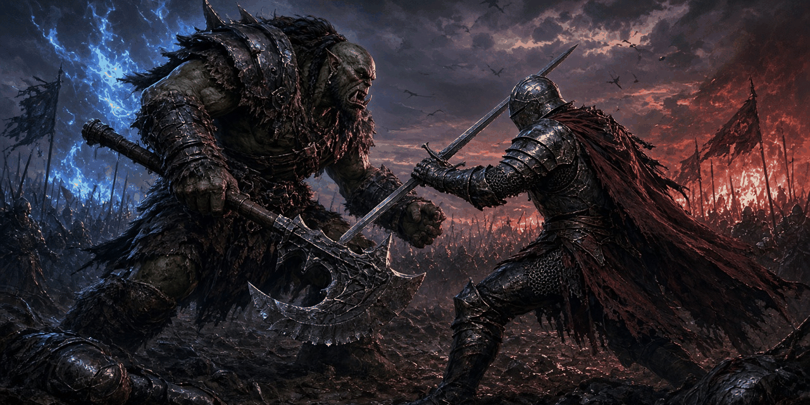

<p align="center">
  
</p>
<p align="center"><em>A World of Warcraft companion for builds, warbands and lore. Offline-first and dark-native.</em></p>

# ⚔️ Open Warcraft

An open-source World of Warcraft companion app. Class builder, warband tracker, lore journal, and ascension planning — built with React Native + Expo.

**Dark-native UI. Offline-first. No account required.**

## Features

- **🏠 Home** — Dashboard with quick links and recent activity
- **⚔️ Class Builder** — Spec planning with gear loadout tracking (rarity-coded slots), simple/advanced modes, rune/loadout configuration
- **🛡️ Warband** — Warband roster management
- **📖 Journal** — Personal notes and tracking
- **📜 Lorekeeper** — Warcraft lore browser with timeline
- **🚀 Ascension** — Ascension planning/progression
- **🎨 Theme Picker** — Multiple dark themes (warcraft-dark and more)

## Tech Stack

- **React Native 0.76** + **Expo 52** (new architecture enabled)
- **TypeScript** — strict, `tsc --noEmit` clean
- **React Navigation** — bottom tabs + drawer + native stack
- Android · iOS · Web (metro)

## Quick Start

```bash
npm install

# Android
npm run android

# iOS
npm run ios

# Web
npm run web

# Type check
npm run typecheck
```

## Project Structure

```
src/
├── App.tsx                  # Navigation root + tab/drawer setup
├── ThemeContext.tsx         # Theme provider (dark themes)
├── theme.ts                 # Theme definitions + types
└── screens/
    ├── HomeScreen.tsx
    ├── ClassBuilderScreen.tsx   # Spec + gear loadout builder
    ├── WarbandScreen.tsx
    ├── JournalScreen.tsx
    ├── LorekeeperScreen.tsx     # Lore timeline browser
    ├── AscensionScreen.tsx
    ├── ThemePickerScreen.tsx
    └── MoreScreen.tsx
```

## Release Notes

- **v1.2.0** — Data persistence: AsyncStorage for journal entries, custom builds, warband roster, ascension progress. Journal screen now fully functional with add/edit/delete/complete. TypeScript config fixed for modern Expo.
- **v1.1.1** — TypeScript hardening: `tsc --noEmit` clean (39 → 0 errors); fixed gear-slot crash in Class Builder (broken `gearSlots` reference + object/string shape mismatch); `StyleSheet.create` constraints added; dead `theme.name` fallback removed; 70MB APK untracked from git (`.apk`/`.aab` gitignored); `npm run typecheck` added.
- **v1.1.0** — Feature release.
- **v1.0.0** — Initial release.

## License

Apache-2.0 — see [LICENSE](LICENSE)

Not affiliated with Blizzard Entertainment. World of Warcraft is a trademark of Blizzard Entertainment, Inc.


---

## ☕ Support the Developer

If this project saved you time, solved a problem, or just made your day a little more neon, you can fuel the next one:

[](https://buymeacoffee.com/synthalorian)

---

<p align="center">
  <br>
  <sub>Built by <a href="https://github.com/synthalorian">the synthalorian</a></sub>
  <br><sub>AI-assisted art: the banner image at the top of this README was made with AI image tools. The synthalorian sprite is code-drawn pixel art.</sub>
</p>
